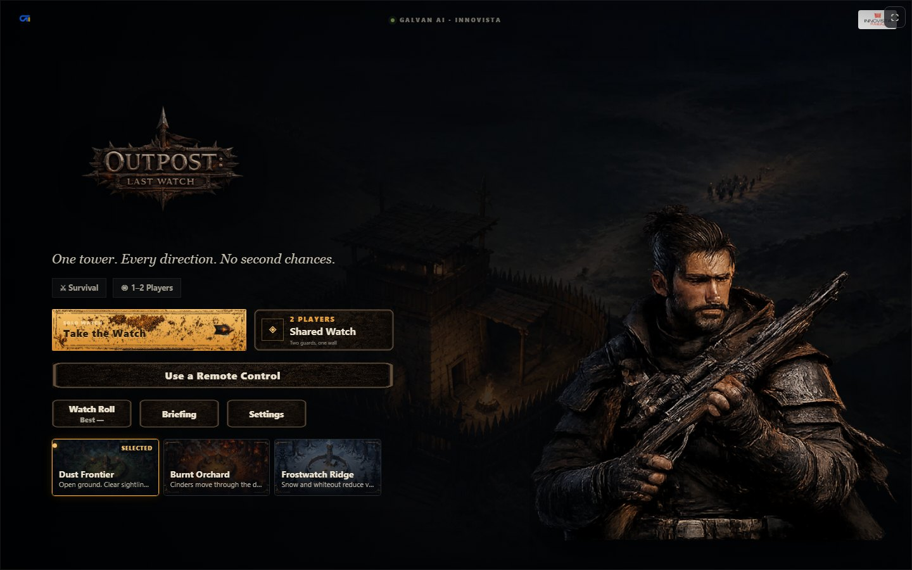
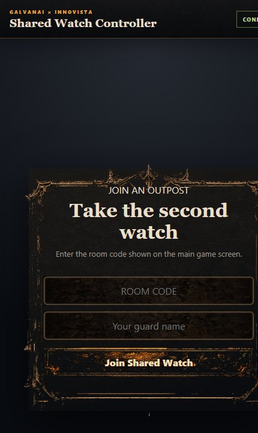

# Outpost: Last Watch

**A browser wave-survival game where you hold a lone watchtower against raiders from every direction, solo or with a friend using their phone as the controller.**

[](https://outpost-last-watch.vercel.app)
[](https://github.com/Umair-Habibx123/outpost-last-watch-mango-mania-season-1/actions/workflows/ci.yml)
[](LICENSE)

**Status:** built for **GalvanAI · Mango Mania · Innovista**, an event held on 13 August 2026, where visitors played it on a kiosk. `master` is the maintained version. The exact build played on the day is kept unchanged on the [`EventDayVersion`](https://github.com/Umair-Habibx123/outpost-last-watch-mango-mania-season-1/tree/EventDayVersion) branch.

**[▶ Play it in your browser](https://outpost-last-watch.vercel.app)**



## What's interesting about it

- **Your phone is the second controller.** A second player scans a QR code and joins on their phone. A refresh or a dropped connection rejoins the same seat within 20 seconds.
- **The phone sees the game as live HD video.** The kiosk streams its screen to the phone over WebRTC, switching between 240p and 1080p as the connection changes, in the same way video sites adapt quality. [How it works](docs/adaptive-streaming.md).
- **A cheat-proof economy.** Coins, unlocks, ammo and upgrades live on the server in Postgres, keyed to a device id. Every purchase and run reward is validated and capped there, so editing the browser grants nothing.
- **No build step.** The client is plain JavaScript and HTML Canvas, served by Express.

## Quick start

You need **Node.js 20+** and a free [Neon](https://neon.tech) Postgres database.

```bash
npm install
```

Create a `.env` file:

```bash
DATABASE_URL=postgres://...      # your Neon connection string
# optional:
PORT=3000
ADMIN_SECRET=choose-a-secret      # enables the host tools below
WS_GRACE_MS=20000                 # how long a dropped player keeps their seat
PUBLIC_URL=http://localhost:3000  # where the join QR code points
```

Then create the tables and start the server:

```bash
npm run db:setup    # safe to run again; it only adds what's missing
npm start           # or: npm run dev, which restarts on changes
```

Open **http://localhost:3000**. To join from a phone on the same Wi-Fi, set `PUBLIC_URL` to your computer's network address, such as `http://192.168.1.20:3000`, so the join QR code points somewhere the phone can reach. Always use the server address; opening `public/index.html` directly has no backend, so the leaderboard, economy and multiplayer won't work.

## How to play

You defend the wall overnight. Raiders, and from wave 3 beast-creatures, come from every direction, and **wall damage carries over between waves**, so mistakes add up. Every 5th wave is a harder **Raid**.

| Control | Action |
|---|---|
| Mouse | Aim |
| Left-click or Space | Fire |
| Q | **Signal Volley** shockwave, when charged |
| 1–6 | Switch weapon |
| Z, X, C, V | Field Kit: Supply Line repair, Backup Team, War Beast, Dragon Strike |

- **Mango supply cart:** grab the cart that crosses the field for a free wall repair. That's the event's mango theme, built into the gameplay.
- **Three battlefields:** Dust Frontier, Burnt Orchard and Frostwatch Ridge, each with its own hazard.
- **Weapons:** start with an unlimited Sidearm, then unlock the Repeater, Scattergun, Siege Cannon, Mortar and Tesla Coil. Each takes ammo and upgrades up to level 5.
- **The Watch Roll:** a leaderboard of the day's top 10 runs, signed as `Company - Player`.

| Dust Frontier | Burnt Orchard | Frostwatch Ridge |
|---|---|---|
|  |  |  |

## Two players: Shared Watch



Pick **Shared Watch** to create a room. The screen shows a QR code and room code; the second player opens it on their phone to play **together** or **against** each other. Both wardens stand on the wall with their own aim and firing.

- **Player 1 is the outpost.** If they leave, the run ends for both.
- **If Player 2 drops,** Player 1 fights on and the second post stays empty until they reconnect. Nothing takes it over in co-op.
- **There's no pause.** A watch runs until it's won or lost.

<br clear="right">

## Host tools

These need `ADMIN_SECRET` set:

- **Export every game as CSV:** `GET /api/admin/leaderboard.csv`, with the secret in the `x-admin-secret` header or as `?secret=`. Add `&day=YYYY-MM-DD` for one day.
- **Reset today's board:** `DELETE /api/admin/leaderboard` with the `x-admin-secret` header.

## How it's built

| Part | What it uses |
|---|---|
| Client | Vanilla JavaScript and HTML Canvas in `public/src/`, with illustrated art in `public/assets/` |
| Server | Node.js, Express and Socket.IO in `server.js` and `server/`, with Helmet, rate limiting and Zod validation |
| Database | Neon Postgres. The schema is in `database/schema.sql`, applied by `database/setup.js` |
| Streaming | WebRTC with an adaptive-bitrate control loop in `public/src/stream.js` |
| Hosting | The live demo runs on Vercel, using `vercel.json` |

```
server.js            Express and Socket.IO entry point
server/              database, rooms, socket events, validation, economy
database/            schema and setup script
public/index.html    the canvas, HUD and every screen
public/src/          game loop, waves, rendering, weapons, maps, multiplayer, streaming
public/assets/       characters, maps, UI art, icons, audio, branding
tools/               art helpers: sprite atlas builder and map fitter
docs/                write-ups on streaming and the art pipeline
```

Further reading:
- [Adaptive bitrate streaming over WebRTC](docs/adaptive-streaming.md)
- [Character atlas pipeline](docs/character-atlas-pipeline.md)
- [Map art pipeline](docs/map-art-pipeline.md)

## Limits

- **Controls:** mouse and keyboard, plus the phone controller. Experimental hand-tracking code is in the repo but turned off, and the AI aim-assist is only a demo aid, so players can't switch it on.
- **A database is required:** without a Neon database the menus load, but the leaderboard, economy and multiplayer don't.

## License

The code and game art are released under the [MIT License](LICENSE) © 2026 Umair Habib.
The GalvanAI and Innovista names and logos in `public/assets/branding/` belong to their owners and are not covered by this license.

Built by [Umair Habib](https://github.com/Umair-Habibx123) for the GalvanAI Mango Mania event.
